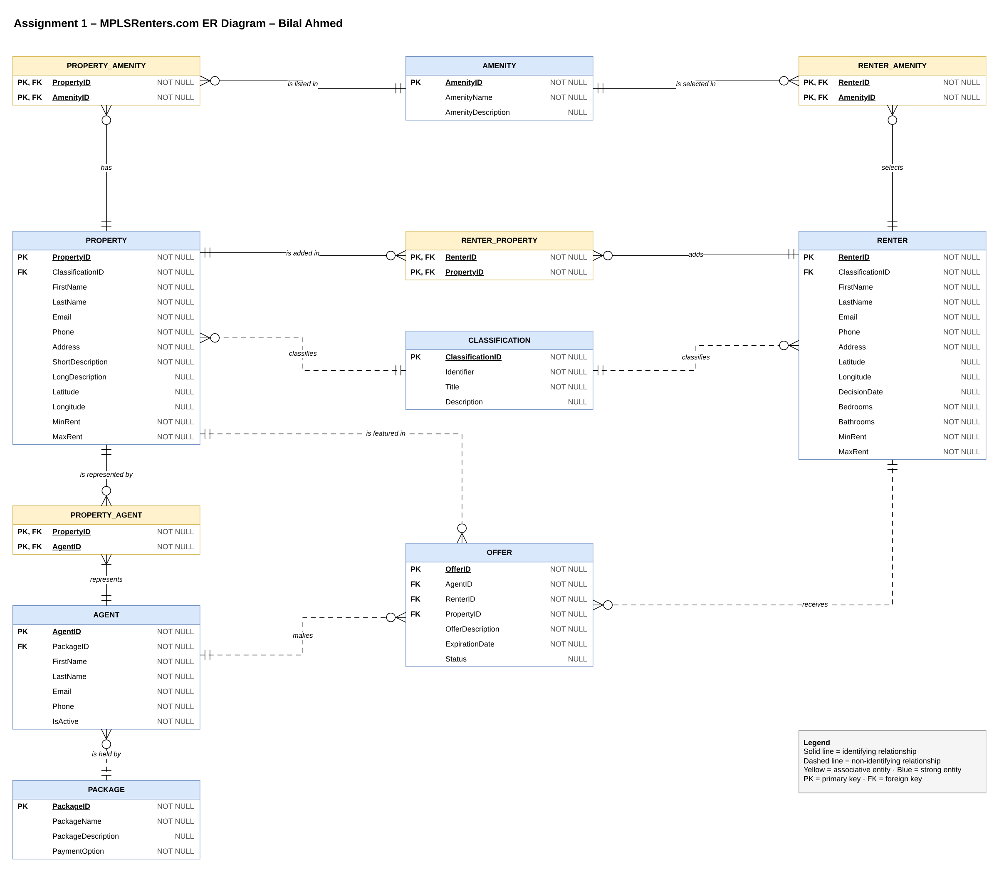

# Assignment 1 - Creating an ER Diagram for MPLSRenters.com
This assignment will meet each of the objectives below:
1. Translate business use cases for data into entity relationships

2. Determine appropriate entity structure for relational databases

3. Apply the correct terminology to a ER Model

4. Design an ER model

## Instructions
For this assignment, your task is to analyze the provided business description and identify the necessary business rules to create an ER diagram. These rules will encompass relationships, constraints, and data requirements.

You are required to compile a README.md file, which will detail each entity along with a brief description of its purpose and the data it collects. Additionally, identify the relationships between entities and note any assumptions or questions you may have for the client based on the business description. You will also decide the answers to your assumptions on behalf of the client.

After completing the README.md file, your next step is to construct an ER Diagram based on the identified relationships from the business description. This diagram should be created using a free web-based tool called 'draw.io.' You'll find the shapes needed for your ER diagram under the 'Entity Relation' tab. Instructions on how to operate draw.io can be found in the assignment resources section below. **DRAW.IO must be used as your ER diagram tool**

## Business Description
MPLSRenters.com is a website that allows prospective apartment renters to create a profile and have
high-end luxury apartments make offers to prospective renters.

1.  A property can have many high-end amenities associated with it. The amenities that are
associated with a property are preset amenities that can be added to a property.  Each amenity will have a name and description. 
 If properties have unique amenities that are not a part of the preset amenities, then those details will go into
the long description for each property. A property will contain information such as first and last name, email, phone, address, short and long description, longitude/latitude of property, and rent range (the lowest and highest amount you can expect to pay).
2. Prospective renters can add as many amenities to their profile as they deem necessary. The amenities will
be the same preset amenities that can be added to a property.  A renter will collect the same information a property would collect, but will also include a renter's decision date, the number of bedrooms and bathrooms, and the lower and max rent value they are willing to spend.  
3. Prospective renters can add as many properties to their profile as they desire. A prospective renter can exist in the system without having a property associated with a profile.
4. A property can have multiple property agents associated with a property. A property does not
have to be associated with a property agent to exist within the database. Property agents can
be activated and deactivated from the system based on whether or not payment for a monthly
package was made on time.
5. Both a profile and a property can receive a classification. There are only three pre-determined
classifications that can be associated with a profile or property. A profile is classified based on
the lower and upper range a prospective renter is looking to have for monthly rent. A
property is classified based on the select amenities, square footage, and lower/upper rent range. Each classification will contain a title, description, and a classification identifier (ex.  A high-luxury, B high - mid-luxury, or C luxury property)
6. A property agent can sign-up for one of three packages. All property agents must have an agent
package. An agent package determines how much access they will be granted to user profile
information.  An Agent package will contain a name, the package description, and an agent option selection (monthly payment package or yearly payment package)
7. Property agents are able to make multiple offers to those who have profiles in the system. A
profile can receive multiple offers from an agent. A profile can decline or entertain an offer.  An offer will contain information such as a description of the offer, the offer expiration date, and the property name for which the offer is being made.

## Submission Guidelines

For this assignment, you will submit 2 items to the repository that has been assigned to you.  The two items that you will need to submit are listed below: 
1. The README.MD file that identifies the various Entities and a brief description of the entity and possible attributes, relationships, and assumptions. 
   1. When identifying relationships be sure to bold and uppercase the entity name, underline the verb and make sure relationships are bi-directional. 
   2. When identifying assumptions, make sure to answer your assumption with either a Yes or No and make sure your response is properly reflected in the ER diagram.  
   3. You can override this README.MD file that contains the instructions or extend this README.MD file by listing your requirements below the Assignment Resources section.

2. The draw.io XML file that contains your ER Diagram.  You will also need to take a snippet of the ER Diagram and add it as an image in your README file.

Once you have completed both of the items above, you will need to submit the link to your repository for assignment 1 prior to the due date and time listed.  Make sure you receive an email confirmation notifying you that the assignment has been submitted.

### Rubric
| Criteria           | Description                             | Points |
| -------------------| --------------------------------------- | ------ |
|**Deliverable 1 - Write-up documented in README.md file**   | Write-up identifies the various entities with brief description (4pts)   Write-up identifies the various relationships that exist between the entities (6pt)   Write-up list assumptions that provides context for cardinality and entity strength (2 pts)   Write-up contains uppercase entity names, underlined verb and relationships are bi-directional (3 pts)  |   15   |
|**Deliverable 2 - Properly structured ER diagram** | All Entities identified in deliverable 1 are visually represented in Workbench ER diagram. (4pts)   Relationship strength is indicated by solid or dotted line (2pt)   Foreign keys and Primary keys are identified and correctly assigned (2 pts)   Each column name indicates null vs not null (2pt)   Image of ER diagram is depicted in README.MD file (2 pt)   Associative entities are identified and properly captures the relationship between the two entities(3 pts)   |   15   |
|           |        |**Total Points:   30**   |

---

# MPLSRenters.com ER Model – Bilal Ahmed

## Entities

| Entity | Description | Possible attributes |
|---|---|---|
| **PROPERTY** | A luxury apartment building listed on the site. | PropertyID (PK), ClassificationID (FK), FirstName, LastName, Email, Phone, Address, ShortDescription, LongDescription, Latitude, Longitude, MinRent, MaxRent |
| **RENTER** | A prospective renter who creates a profile on the site. | RenterID (PK), ClassificationID (FK), FirstName, LastName, Email, Phone, Address, Latitude, Longitude, DecisionDate, Bedrooms, Bathrooms, MinRent, MaxRent |
| **AMENITY** | The preset list of high-end amenities (pool, gym, etc.) that properties and renters can pick from. | AmenityID (PK), AmenityName, AmenityDescription |
| **AGENT** | A property agent who represents properties and makes offers to renters. | AgentID (PK), PackageID (FK), FirstName, LastName, Email, Phone, IsActive |
| **CLASSIFICATION** | One of three preset classifications (A, B, C) given to renters and properties. | ClassificationID (PK), Identifier, Title, Description |
| **PACKAGE** | One of three agent packages that controls how much renter info an agent can see. | PackageID (PK), PackageName, PackageDescription, PaymentOption |
| **OFFER** | An offer an agent sends to a renter for a specific property. | OfferID (PK), AgentID (FK), RenterID (FK), PropertyID (FK), OfferDescription, ExpirationDate, Status |
| **PROPERTY_AMENITY** | Associative entity linking properties to their amenities. | PropertyID (PK, FK), AmenityID (PK, FK) |
| **RENTER_AMENITY** | Associative entity linking renters to the amenities they want. | RenterID (PK, FK), AmenityID (PK, FK) |
| **RENTER_PROPERTY** | Associative entity linking renters to properties they added to their profile. | RenterID (PK, FK), PropertyID (PK, FK) |
| **PROPERTY_AGENT** | Associative entity linking agents to the properties they represent. | PropertyID (PK, FK), AgentID (PK, FK) |

## Relationships

1. A **PROPERTY** <ins>has</ins> zero or many **AMENITIES**. An **AMENITY** <ins>belongs to</ins> zero or many **PROPERTIES**. (M:N, resolved by **PROPERTY_AMENITY**)
2. A **RENTER** <ins>selects</ins> zero or many **AMENITIES**. An **AMENITY** <ins>is selected by</ins> zero or many **RENTERS**. (M:N, resolved by **RENTER_AMENITY**)
3. A **RENTER** <ins>adds</ins> zero or many **PROPERTIES**. A **PROPERTY** <ins>is added by</ins> zero or many **RENTERS**. (M:N, resolved by **RENTER_PROPERTY**)
4. A **PROPERTY** <ins>is represented by</ins> zero or many **AGENTS**. An **AGENT** <ins>represents</ins> one or many **PROPERTIES**. (M:N, resolved by **PROPERTY_AGENT**)
5. A **CLASSIFICATION** <ins>classifies</ins> zero or many **RENTERS**. A **RENTER** <ins>is classified by</ins> one and only one **CLASSIFICATION**.
6. A **CLASSIFICATION** <ins>classifies</ins> zero or many **PROPERTIES**. A **PROPERTY** <ins>is classified by</ins> one and only one **CLASSIFICATION**.
7. A **PACKAGE** <ins>is held by</ins> zero or many **AGENTS**. An **AGENT** <ins>holds</ins> one and only one **PACKAGE**.
8. An **AGENT** <ins>makes</ins> zero or many **OFFERS**. An **OFFER** <ins>is made by</ins> one and only one **AGENT**.
9. A **RENTER** <ins>receives</ins> zero or many **OFFERS**. An **OFFER** <ins>is sent to</ins> one and only one **RENTER**.
10. A **PROPERTY** <ins>is featured in</ins> zero or many **OFFERS**. An **OFFER** <ins>is for</ins> one and only one **PROPERTY**.

## Assumptions

1. Must an **AGENT** represent at least one **PROPERTY**? **Yes.**
2. Can one **OFFER** be for more than one **PROPERTY**? **No.** Each offer is for exactly one property.
3. Can an **AGENT** send the same **RENTER** more than one **OFFER**? **Yes.** That's why OFFER has its own OfferID instead of a composite key.
4. Does an offer have a status before the **RENTER** responds? **No.** Status stays NULL until the renter accepts or declines.
5. Can an **AMENITY**, **CLASSIFICATION**, or **PACKAGE** exist before anyone uses it? **Yes.** They're preset lists, so their minimum is zero.
6. Is a deactivated **AGENT** deleted from the database? **No.** They stay in the database with IsActive set to No.
7. Can an associative entity (like **PROPERTY_AMENITY**) exist without both of its parents? **No.** Associative entities are weak and use identifying (solid) relationships. All other entities are strong, and their relationships are non-identifying (dotted).
8. Can a **RENTER** or **PROPERTY** have more than one **CLASSIFICATION**? **No.** Each has exactly one.

## ER Diagram

